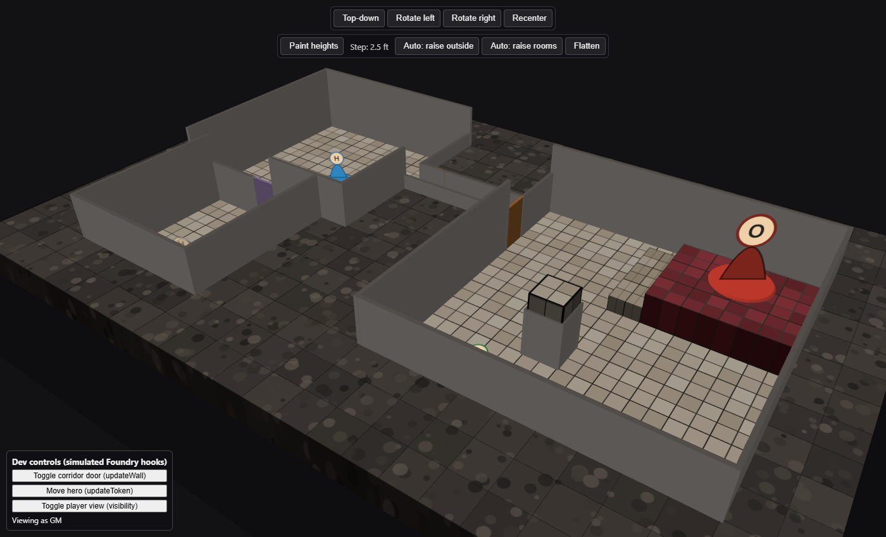

# Foundry 3D View

A Foundry VTT module that shows the current scene in 3D, tactics-RPG style. The map becomes terrain
you can raise square by square, walls are extruded, doors open and close live, and tokens stand
on the map as paper standees. The 2D scene stays as it is: the 3D view is an overlay you toggle on
and off.

- **Foundry:** v13 (primary), v14 (should work, not tested yet). Square or gridless scenes. Works with any system.
- **No build step:** plain ES modules. three.js r187 is vendored in `vendor/three/` (MIT, see `vendor/three/LICENSE`).
- **Original code:** written from scratch against Foundry's public API and three.js. It is not derived from any other 3D module.



## Features (milestone 1)

| Feature | Notes |
|---|---|
| Toggle the 3D view | **Token controls → cube button**, or the keybinding **Shift+V** (rebindable). There is also an API: `game.modules.get("foundry-3d-view").api.toggle()`. |
| Floor | The scene background is a textured ground at the correct scale: grid size, padding and background offset are all applied. |
| Walls | Each wall that blocks sight becomes a box. Invisible walls are skipped. If a wall has `wall-height` flags (from the Wall Height module), those set its top and bottom. |
| Doors | Each door is its own mesh, hinged at the first point of the wall. It swings open or closed with an animation on `updateWall`. To players, a closed secret door looks like a plain wall. |
| Tokens | Token art is shown as an upright card that always faces the camera. It sits on a base coloured by disposition, at the token's grid position and elevation. Cards follow Foundry's movement animation (`refreshToken`) and lie flat in top-down view. |
| Heights per square | Stored in the scene flag `flags.foundry-3d-view.heights` as `{cols, rows, data[]}`, in grid distance units (the same units as token elevation). Tokens stand on `max(terrain under the token, elevation)`. |
| GM height tool | **Paint heights**: left-click raises a square by one step, right-click or Shift+click lowers it. **Auto: raise outside** / **Auto: raise rooms** make a rough first pass from the walls. **Flatten** resets everything to 0. |
| Camera | Orbit (left-drag), pan (right-drag), zoom (wheel), 45° rotate buttons, recenter, and a top-down toggle. The view can be windowed (picture-in-picture) so the 2D canvas stays usable beside it. |
| Visibility | Players see only the tokens that Foundry's `Token#isVisible` allows (their vision, plus hidden tokens). The GM sees hidden tokens as semi-transparent ghosts. |

Settings: wall height (squares), height paint step (squares), and show grid in 3D (per client).
UI text is in English and pt-BR (`lang/`).

## Installing into Foundry

Foundry is not installed on the development machine, so the module has **not been run inside Foundry yet**. To install it, put this folder in your Foundry data folder under `Data/modules/foundry-3d-view` (the folder name must equal the `id` in `module.json`).

Windows, with a symlink so edits show up right away (run in an admin PowerShell, or with Developer Mode on):

```powershell
New-Item -ItemType SymbolicLink `
  -Path "$env:LOCALAPPDATA\FoundryVTT\Data\modules\foundry-3d-view" `
  -Target "C:\path\to\this\repo"
```

Linux/macOS:

```sh
ln -s /path/to/this/repo ~/.local/share/FoundryVTT/Data/modules/foundry-3d-view      # Linux
ln -s /path/to/this/repo ~/Library/Application\ Support/FoundryVTT/Data/modules/foundry-3d-view  # macOS
```

You can also copy the folder there instead. Only `module.json`, `scripts/`, `styles/`, `lang/` and `vendor/` are needed at runtime.
Then restart Foundry, enable **Foundry 3D View** in *Manage Modules*, open a scene, and click the cube button in the Token controls.

### First things to check in a real Foundry (unverified so far)

- The overlay is inserted right after `#board`, so Foundry's UI stays on top. Check that the sidebar and scene controls are still clickable while the view is open.
- `getSceneControlButtons` with the v13 object API: the cube tool should appear under Token controls.
- Token positions during movement: `refreshToken` reads the placeable's `x/y`.
- v14: the background is looked up in this order: `scene.background`, then the first level's background, then `scene.img`.

## Development

```sh
npm install          # three + vitest (dev only)
npm test             # unit tests: coordinates, walls/doors, heights, auto pass, terrain mesh, scene model
npm run dev          # static server → http://localhost:8173/dev/
npm run screenshot   # headless Edge/Chrome renders dev/screenshots/*.png
npm run selftest     # headless browser smoke test of the live-update paths
npm run vendor       # re-copy three.js from node_modules into vendor/three
node dev/make-sample.mjs   # regenerate dev/sample-scene.json
```

The **dev page** (`dev/index.html`) renders `dev/sample-scene.json` with the same renderer and toolbar
the module uses. The map and token art are drawn on a canvas, so the repo has no images. Buttons on the page simulate
the Foundry hooks (door update, token move, player view). URL params: `?topdown=1`, `?player=1`, `?az=<deg>`, `?paint=1`.

Screenshots: `dev/screenshots/dev-page-orbit.png`, `dev-page-topdown.png`, `dev-page-player.png`, `dev-page-paint.png`.

### Layout

```
module.json
scripts/main.mjs              settings, keybinding, scene control, API
scripts/foundry/controller.mjs overlay + hooks (Foundry-only code lives here)
scripts/render/view3d.mjs     three.js renderer (knows nothing about Foundry)
scripts/ui/hud.mjs            toolbar + GM height painter (plain DOM)
scripts/core/*.mjs            pure logic, unit-tested: coords, heights, walls, terrain, scene-model
vendor/three/                 three.module.js, three.core.js, OrbitControls.js (import rewritten), LICENSE
dev/                          standalone dev page, sample scene, screenshots
tests/                        vitest
```

Coordinates: one world unit is one grid square. World x = canvas x, world z = canvas y, and y is up.
The origin is the centre of the scene rect. Vertical values are in grid distance units divided by `grid.distance`.

## Next milestones

1. **Lighting, vision and fog in 3D.** Project Foundry's fog-of-war and vision polygons onto the terrain, and show light sources as three.js lights. Hide walls and terrain the player hasn't explored. *(TODO: today, players see every wall and the whole map in 3D. Only tokens are vision-limited.)*
2. **Walls lowering toward the camera.** Fade or cut walls that sit between the camera and the focused token, as tactics games do.
3. **Interaction in 3D.** Click a token to select or control it, click a square to move, open doors by clicking them, and show a ruler.
4. **Tiles.** Show overhead and floor tiles as textured planes or blocks.
5. **v14 levels.** Use the v14 native scene levels, with one stacked floor per level, and wall bottom/top from core data.
6. Smaller items: video tokens and backgrounds (partly supported), token rings, brush sizes and undo for the height tool, a sloped stair tool, and performance work for very large maps (instancing, merged wall geometry).

## License

MIT for this module's code (see `LICENSE`). three.js is MIT, © three.js authors (`vendor/three/LICENSE`).
